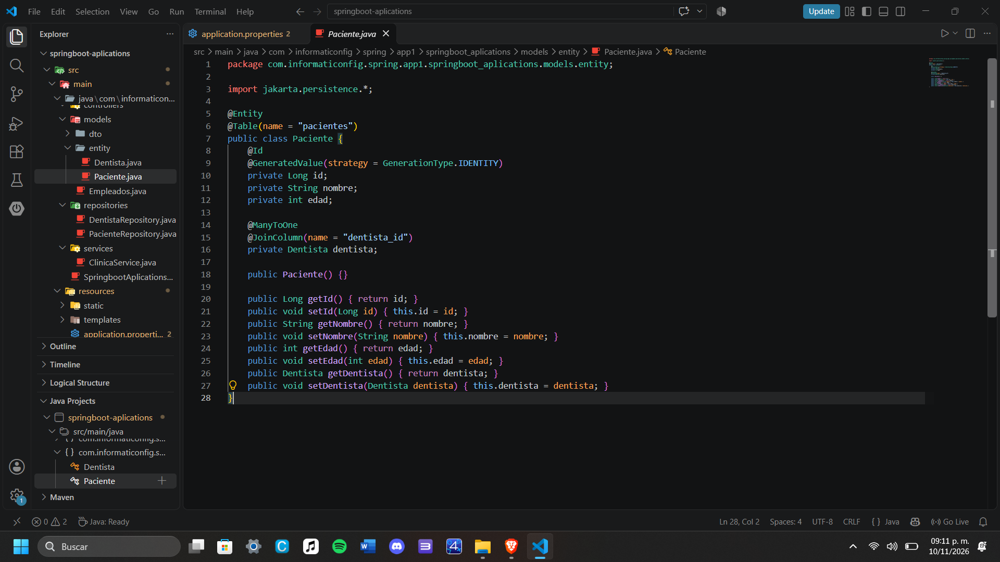
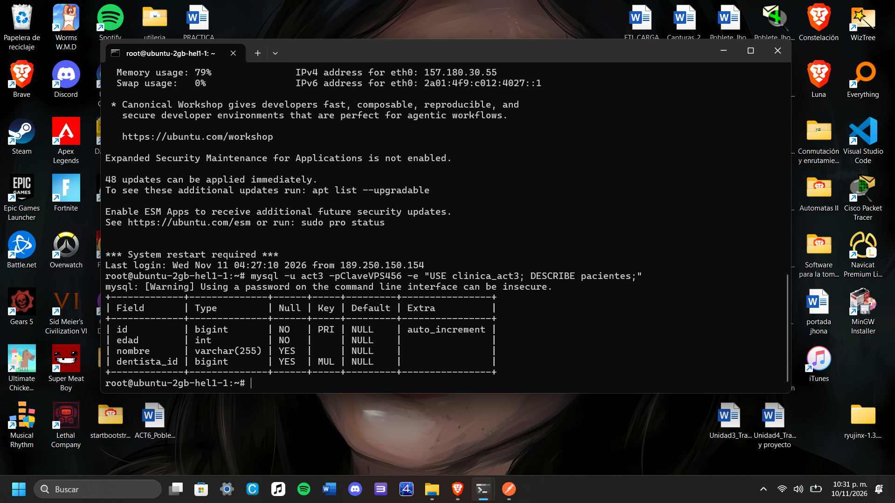
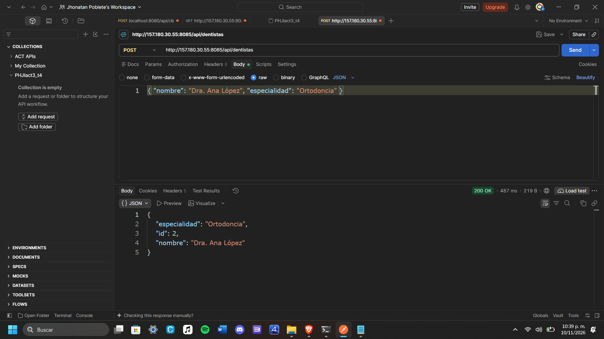
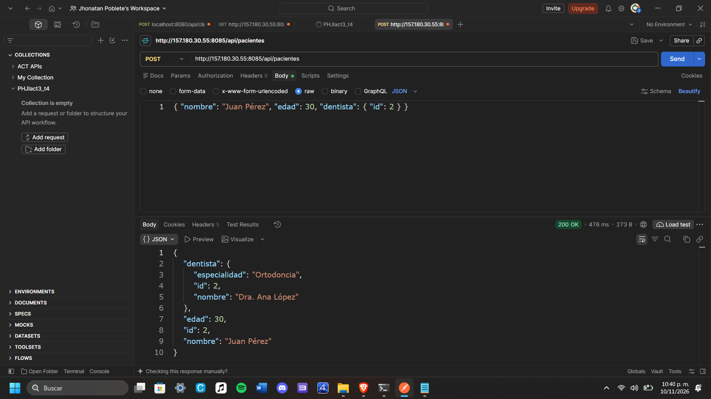
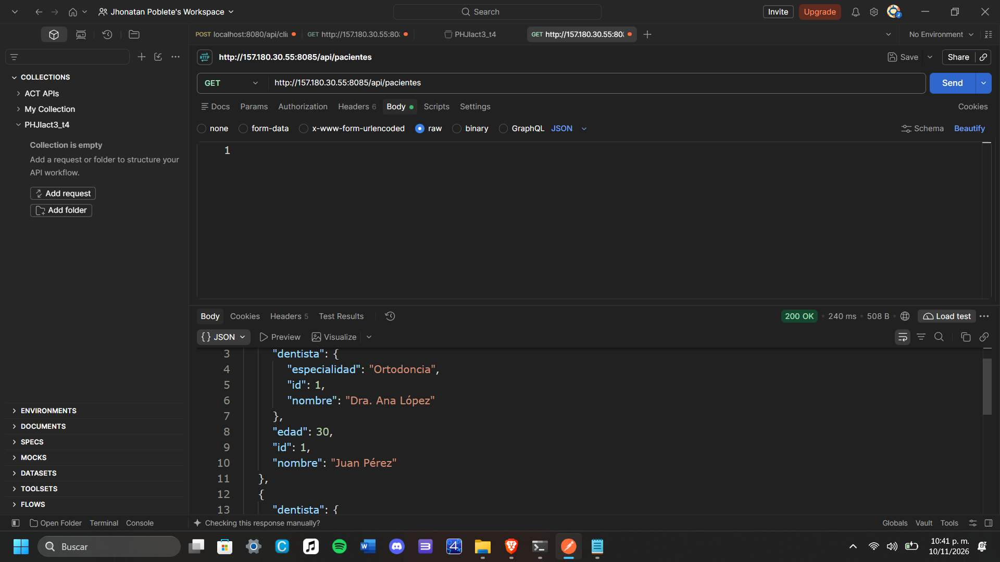
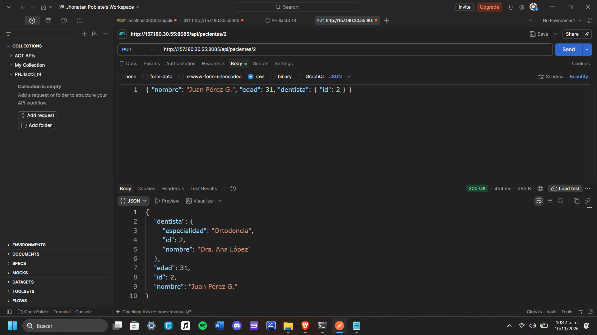
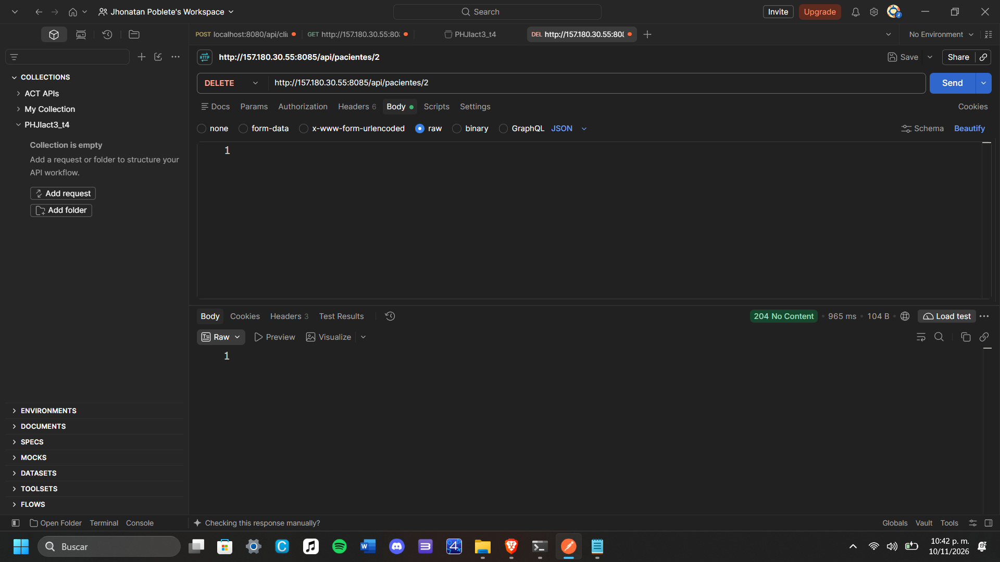
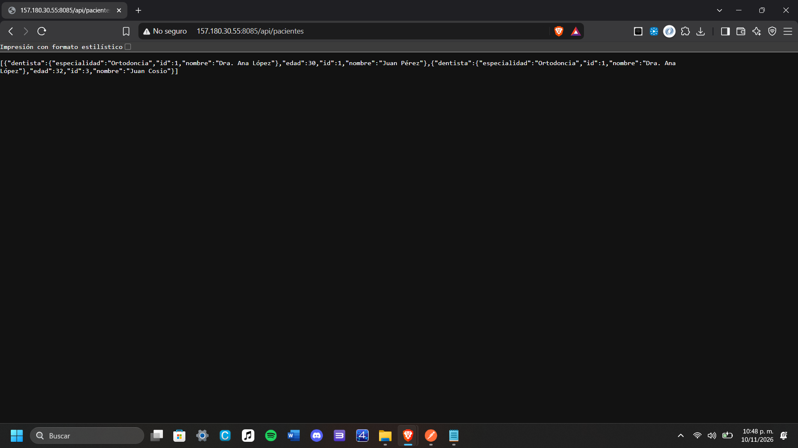
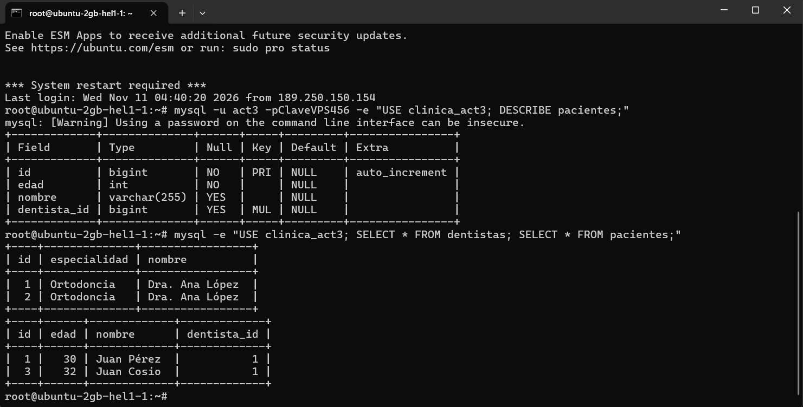

# Actividad 3 - CRUD con Spring Boot, JPA y MySQL
CRUD de pacientes de una clínica dental con una relación entre dos entidades (Paciente y Dentista), conectado a MySQL y desplegado en un VPS.

## Tecnologías
Spring Boot, Spring Data JPA, MySQL, Thymeleaf, Maven.

## Estructura
- `models/entity`: entidades `Dentista` y `Paciente`
- `repositories`: `DentistaRepository` y `PacienteRepository` (extienden `JpaRepository`)
- `services`: `ClinicaService` (lógica de negocio)
- `controllers`: `PacienteApiController` (endpoints REST)

## 1. Entidades y relación
Un dentista tiene muchos pacientes. Se implementó con `@ManyToOne` y `@JoinColumn(name = "dentista_id")` en `Paciente`.

Tablas en MySQL, con la llave foránea `dentista_id`:

## 2. CRUD

### Crear
`POST /api/dentistas`

`POST /api/pacientes`

### Leer
`GET /api/pacientes`

### Actualizar
`PUT /api/pacientes/1`

### Eliminar
`DELETE /api/pacientes/1`

## 3. Relación reflejada
Al consultar un paciente se muestra el dentista completo, con su nombre y no solo el ID.

## 4. Datos guardados en MySQL (VPS)

## Endpoints

| Método | Ruta | Descripción |
|---|---|---|
| POST | `/api/dentistas` | Crear dentista |
| GET | `/api/dentistas` | Listar dentistas |
| POST | `/api/pacientes` | Crear paciente |
| GET | `/api/pacientes` | Listar pacientes |
| GET | `/api/pacientes/{id}` | Ver un paciente |
| PUT | `/api/pacientes/{id}` | Actualizar paciente |
| DELETE | `/api/pacientes/{id}` | Eliminar paciente |

## Configuración
La conexión a la base se lee de variables de entorno (`DB_URL`, `DB_USER`, `DB_PASS`), así no se suben credenciales al repositorio.

## Despliegue en el VPS
- Actividad 3: http://157.180.30.55:8085/api/pacientes
- Actividad 1 (sigue corriendo): http://157.180.30.55:8081/proyecto
- Actividad 2 (sigue corriendo): http://157.180.30.55:8083/clinica/empleados
